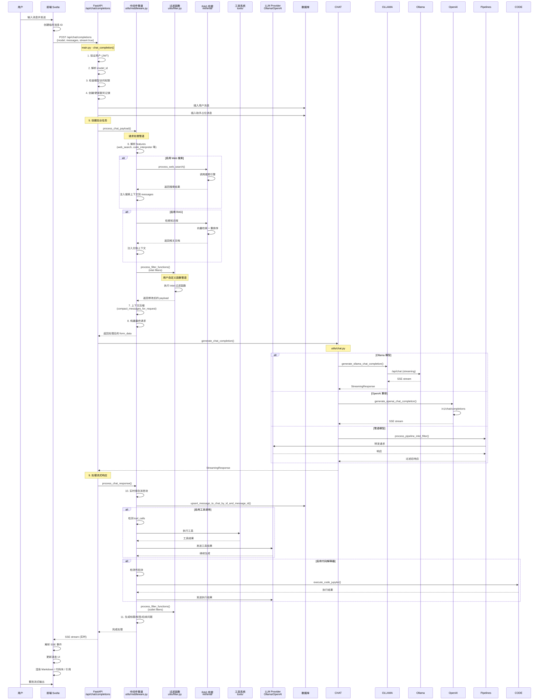
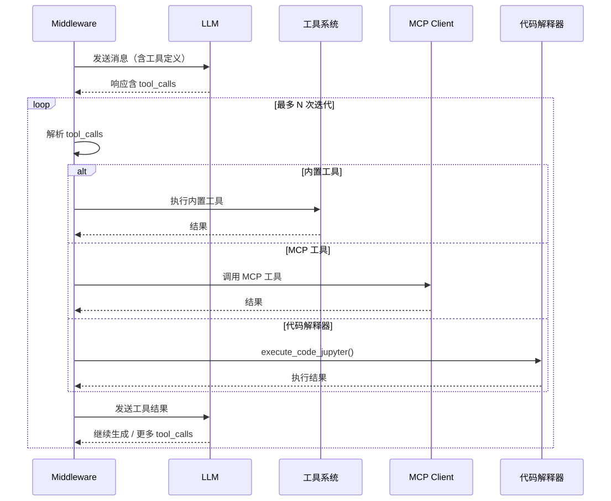
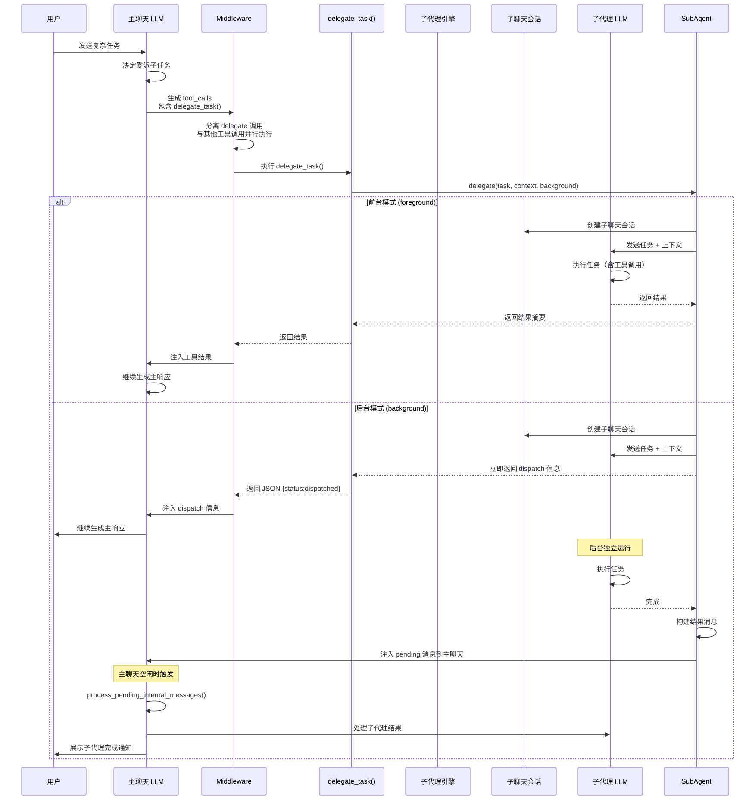

# Open WebUI 架构设计文档

> 基于 graphify 知识图谱分析生成
> 项目: [open-webui/open-webui](https://github.com/open-webui/open-webui)

---

## 目录

1. [总体架构概览](#1-总体架构概览)
2. [前端架构](#2-前端架构)
3. [后端模块依赖图](#3-后端模块依赖图)
4. [一次聊天请求生命周期](#4-一次聊天请求生命周期)
5. [多 Agent 系统](#5-多-agent-系统)
6. [关键文件路径索引](#6-关键文件路径索引)
7. [核心类与函数](#7-核心类与函数)

---

## 1. 总体架构概览

Open WebUI 是一个**前后端分离**的 LLM 聊天界面平台，采用 **FastAPI (Python)** 后端 + **Svelte 5 (TypeScript)** 前端架构。



### 核心架构原则

| 原则 | 说明 |
|------|------|
| **前后端分离** | Svelte SPA + FastAPI REST API，通过 HTTP/WebSocket 通信 |
| **Provider 抽象** | Ollama / OpenAI / 自定义 Provider 统一通过 `app.state.MODELS` 管理 |
| **管道过滤** | 请求/响应经过 Filter Pipeline（内置 + 自定义函数） |
| **事件驱动** | 内置事件系统（`EVENTS`），支持 Webhook 通知 |
| **插件化** | Functions（Python 脚本）、Tools（MCP/OpenAPI）、Pipelines 三层扩展 |

---

## 2. 前端架构

### 2.1 路由结构



### 2.2 前端组件层次



### 2.3 前端关键文件

| 文件路径 | 职责 |
|----------|------|
| `src/routes/+layout.svelte` | 全局布局：Socket.IO 连接、主题、i18n、Pyodide 初始化 |
| `src/routes/(app)/+layout.svelte` | 主应用布局：侧边栏、导航、聊天列表 |
| `src/routes/(app)/c/[id]/+page.svelte` | 聊天会话页面 |
| `src/lib/components/chat/Chat.svelte` | 聊天主组件 |
| `src/lib/components/chat/Messages/Message.svelte` | 消息渲染 |
| `src/lib/components/chat/Messages/Markdown/extension.ts` | Markdown 扩展渲染 |
| `src/lib/apis/index.ts` | API 客户端统一入口 |
| `src/lib/apis/chats/index.ts` | 聊天 API |
| `src/lib/stores/index.ts` | 全局状态管理 |
| `src/lib/stores/chatList.ts` | 聊天列表状态 |
| `src/lib/utils/index.ts` | 工具函数 |

---

## 3. 后端模块依赖图

### 3.1 模块依赖关系


### 3.2 后端目录结构

```
backend/open_webui/
├── main.py                    # FastAPI 应用入口，路由注册，生命周期
├── config.py                  # 配置加载（数据库、OAuth、RAG 等）
├── env.py                     # 环境变量定义
├── events.py                  # 事件系统（EVENTS 枚举）
├── functions.py               # 函数管道执行引擎
├── tasks.py                   # 后台任务管理
├── constants.py               # 常量定义
│
├── routers/                   # REST API 路由
│   ├── chats.py               # 聊天 CRUD
│   ├── ollama.py              # Ollama 代理
│   ├── openai.py              # OpenAI 兼容代理
│   ├── auths.py               # 认证
│   ├── users.py               # 用户管理
│   ├── models.py              # 模型管理
│   ├── retrieval.py           # RAG 检索
│   ├── files.py               # 文件管理
│   ├── tools.py               # 工具管理
│   ├── functions.py           # 函数管理
│   ├── knowledge.py           # 知识库
│   ├── configs.py             # 系统配置
│   ├── images.py              # 图像生成
│   ├── audio.py               # 语音
│   ├── tasks.py               # 后台任务
│   ├── channels.py            # 频道
│   ├── evaluations.py         # 评估
│   ├── analytics.py           # 分析
│   ├── automations.py         # 自动化
│   ├── calendar.py            # 日历
│   ├── notes.py               # 笔记
│   ├── pipelines.py           # 管道
│   ├── scim.py                # SCIM 身份管理
│   ├── prompts.py             # 提示词
│   ├── skills.py              # 技能
│   ├── groups.py              # 用户组
│   ├── folders.py             # 文件夹
│   ├── memories.py            # 记忆
│   ├── notifications.py       # 通知
│   ├── terminals.py           # 终端
│   └── utils.py               # 工具路由
│
├── models/                    # 数据模型层
│   ├── chats.py               # 聊天
│   ├── messages.py            # 消息
│   ├── chat_messages.py       # 聊天消息（新）
│   ├── users.py               # 用户
│   ├── models.py              # 模型
│   ├── files.py               # 文件
│   ├── config.py              # 配置
│   ├── knowledge.py           # 知识库
│   ├── tools.py               # 工具
│   ├── functions.py           # 函数
│   ├── channels.py            # 频道
│   ├── groups.py              # 用户组
│   ├── folders.py             # 文件夹
│   ├── tags.py                # 标签
│   ├── memories.py            # 记忆
│   ├── notes.py               # 笔记
│   ├── automations.py         # 自动化
│   ├── feedbacks.py           # 反馈
│   ├── prompts.py             # 提示词
│   ├── skills.py              # 技能
│   ├── access_grants.py       # 访问授权
│   ├── oauth_sessions.py      # OAuth 会话
│   └── shared_chats.py        # 共享聊天
│
├── retrieval/                 # RAG 检索系统
│   ├── utils.py               # 检索主逻辑
│   ├── external.py            # 外部检索
│   ├── loaders/               # 文档加载器
│   │   ├── main.py            # 加载器入口
│   │   ├── external_document.py
│   │   ├── external_web.py
│   │   ├── youtube.py
│   │   ├── tavily.py
│   │   ├── mistral.py
│   │   ├── mineru.py
│   │   └── ...
│   ├── web/                   # Web 搜索引擎
│   │   ├── main.py            # 搜索入口
│   │   ├── duckduckgo.py
│   │   ├── google_pse.py
│   │   ├── bing.py
│   │   ├── brave.py
│   │   ├── searxng.py
│   │   ├── tavily.py
│   │   ├── jina_search.py
│   │   └── ... (20+ 引擎)
│   ├── vector/                # 向量数据库
│   │   ├── main.py            # 向量操作入口
│   │   ├── factory.py         # 工厂模式
│   │   ├── type.py            # 类型定义
│   │   ├── utils.py           # 工具函数
│   │   ├── async_client.py    # 异步客户端
│   │   └── dbs/               # 具体实现
│   │       ├── chroma.py
│   │       ├── qdrant.py
│   │       ├── qdrant_multitenancy.py
│   │       ├── pgvector.py
│   │       ├── milvus.py
│   │       ├── milvus_multitenancy.py
│   │       ├── elasticsearch.py
│   │       ├── opensearch.py
│   │       ├── pinecone.py
│   │       ├── weaviate.py
│   │       ├── valkey.py
│   │       ├── mariadb_vector.py
│   │       └── ...
│   └── models/                # 重排序模型
│       ├── base_reranker.py
│       ├── colbert.py
│       └── external.py
│
├── utils/                     # 工具库
│   ├── chat.py                # 聊天补全引擎
│   ├── middleware.py          # 请求处理管道（核心）
│   ├── payload.py             # 负载格式转换
│   ├── response.py            # 响应格式转换
│   ├── filter.py              # 过滤函数系统
│   ├── models.py              # 模型管理
│   ├── embeddings.py          # 嵌入生成
│   ├── session_pool.py        # 会话池
│   ├── subagents.py           # 子代理系统
│   ├── mcp/client.py          # MCP 客户端
│   ├── tools.py               # 工具服务器
│   ├── context_compaction.py  # 上下文压缩
│   ├── code_interpreter.py    # 代码解释器
│   ├── auth.py                # 认证
│   ├── audit.py               # 审计日志
│   ├── redis.py               # Redis 客户端
│   ├── files.py               # 文件处理
│   ├── memory.py              # 记忆系统
│   ├── chat_id.py             # 聊天 ID 工具
│   ├── chat_variables.py      # 聊天变量
│   ├── chat_fork.py           # 聊天分叉
│   ├── model_ids.py           # 模型 ID 处理
│   ├── oauth.py               # OAuth
│   ├── webhook.py             # Webhook
│   ├── rate_limit.py          # 限流
│   ├── sanitize.py            # 数据清洗
│   ├── validate.py            # 验证
│   ├── valves.py              # Valves 系统
│   ├── actions.py             # 聊天动作
│   ├── automations.py         # 自动化调度
│   ├── channels.py            # 频道工具
│   ├── calendar.py            # 日历工具
│   ├── notifications.py       # 通知
│   ├── terminals.py           # 终端
│   ├── timers.py              # 定时器
│   ├── task.py                # 任务工具
│   ├── plugin.py              # 插件系统
│   ├── pdf_generator.py       # PDF 生成
│   ├── json_codec.py          # JSON 编解码
│   ├── json_response.py       # JSON 响应
│   ├── logger.py              # 日志
│   ├── misc.py                # 杂项
│   ├── headers.py             # 请求头
│   ├── security_headers.py    # 安全头
│   ├── asgi_middleware.py     # ASGI 中间件
│   ├── anthropic.py           # Anthropic 兼容
│   ├── images/                # 图像处理
│   │   └── comfyui.py         # ComfyUI 集成
│   ├── access_control/        # 访问控制
│   │   ├── __init__.py
│   │   ├── files.py
│   │   └── folders.py
│   └── telemetry/             # OpenTelemetry
│       ├── setup.py
│       ├── metrics.py
│       ├── logs.py
│       ├── instrumentors.py
│       └── constants.py
│
├── socket/                    # WebSocket / Socket.IO
│   ├── main.py                # Socket.IO 服务
│   └── utils.py               # Socket 工具
│
├── storage/                   # 文件存储
│   └── provider.py            # 存储提供者
│
├── tools/                     # 内置工具
│   ├── __init__.py
│   ├── builtin.py             # 内置工具
│   └── knowledge_fs.py        # 知识库文件系统
│
├── internal/                  # 内部模块
│   └── db.py                  # 数据库引擎
│
└── migrations/                # 数据库迁移
    ├── env.py
    ├── util.py
    └── versions/              # 迁移版本
```

---

## 4. 一次聊天请求生命周期

### 4.1 完整流程



### 4.2 请求处理管道详解



### 4.3 工具调用循环



---

## 5. 多 Agent 系统

Open WebUI 内置了完整的 **子代理 (Sub-agent)** 系统，允许 LLM 在对话过程中动态委派任务给并行运行的子代理。每个子代理拥有独立的聊天会话和完整的工具访问权限。

### 5.1 架构概览



### 5.2 子代理工作流程



### 5.3 关键配置项

| 配置项 | 环境变量 | 默认值 | 说明 |
|--------|----------|--------|------|
| 启用子代理 | `ENABLE_SUBAGENTS` | `false` | 全局开关 |
| 后台模式 | `SUBAGENTS_BACKGROUND_ENABLED` | `false` | 允许后台运行 |
| 最大并发 | `SUBAGENTS_MAX_CONCURRENT` | `20` | 前台子代理并发数 |
| 最大后台 | `SUBAGENTS_MAX_ASYNC` | `20` | 后台子代理并发数 |
| 最大迭代 | `SUBAGENTS_MAX_ITERATIONS` | `30` | 每个子代理工具循环次数 |
| 最大输出 | `SUBAGENTS_MAX_OUTPUT` | `30000` | 结果摘要最大字符数 |
| 系统提示词 | `SUBAGENTS_SYSTEM_PROMPT` | `''` | 自定义子代理系统提示词 |

### 5.4 关键文件

| 文件 | 职责 |
|------|------|
| `backend/open_webui/utils/subagents.py` | 子代理引擎核心：`delegate()`、`process_pending_internal_messages()` |
| `backend/open_webui/tools/builtin.py` | `delegate_task()` 内置工具函数定义 |
| `backend/open_webui/utils/tools.py` | 工具注册：将 `delegate_task` 注册为内置工具 |
| `backend/open_webui/utils/middleware.py` | 工具调用循环中特殊处理 `delegate_task`（并行执行） |
| `backend/open_webui/utils/timers.py` | 定时器引擎 |
| `backend/open_webui/config.py` | 子代理配置项 |
| `src/lib/components/admin/Settings/Subagents.svelte` | 管理后台子代理设置界面 |
| `src/lib/components/chat/Messages/SubagentResultRow.svelte` | 后台子代理结果展示组件 |

### 5.5 设计要点

1. **递归防护**：子代理内部标记 `internal=True`，禁止递归委派，防止无限循环
2. **并行执行**：`delegate_task` 调用与其他工具调用并行执行（`asyncio.gather`），不阻塞普通工具
3. **后台注入**：后台子代理完成后，结果以 `pending` 状态消息注入主聊天，等待主聊天空闲时自动处理
4. **完整工具链**：子代理拥有与主聊天相同的工具访问权限（MCP、代码解释器、文件系统等）
5. **定时器集成**：`timer()` 工具允许设置一次性定时器，在指定时间后自动注入消息
6. **信号量控制**：前台子代理使用 `asyncio.Semaphore` 控制并发，后台使用 `_background_active` 集合跟踪

---

### 5.1 前端关键文件

| 类别 | 文件路径 | 说明 |
|------|----------|------|
| **入口** | `src/routes/+layout.svelte` | 全局布局，Socket.IO 连接初始化 |
| **入口** | `src/routes/(app)/+layout.svelte` | 主应用布局，侧边栏 |
| **入口** | `src/routes/(app)/+page.svelte` | 首页（聊天列表） |
| **聊天** | `src/routes/(app)/c/[id]/+page.svelte` | 聊天会话页 |
| **聊天** | `src/lib/components/chat/Chat.svelte` | 聊天主组件 |
| **消息** | `src/lib/components/chat/Messages/Message.svelte` | 消息渲染 |
| **消息** | `src/lib/components/chat/Messages/UserMessage.svelte` | 用户消息 |
| **消息** | `src/lib/components/chat/Messages/AssistantMessage.svelte` | 助手消息 |
| **Markdown** | `src/lib/components/chat/Messages/Markdown/extension.ts` | Markdown 扩展 |
| **Markdown** | `src/lib/components/chat/Messages/Markdown/MarkdownTokens.svelte` | Markdown 令牌渲染 |
| **输入** | `src/lib/components/chat/ChatInput.svelte` | 聊天输入框 |
| **侧边栏** | `src/lib/components/app/AppSidebar.svelte` | 应用侧边栏 |
| **设置** | `src/lib/components/chat/Settings/` | 设置面板 |
| **API** | `src/lib/apis/index.ts` | API 客户端统一入口 |
| **API** | `src/lib/apis/chats/index.ts` | 聊天 API |
| **API** | `src/lib/apis/models/index.ts` | 模型 API |
| **API** | `src/lib/apis/auths/index.ts` | 认证 API |
| **API** | `src/lib/apis/retrieval/index.ts` | 检索 API |
| **API** | `src/lib/apis/files/index.ts` | 文件 API |
| **API** | `src/lib/apis/tools/index.ts` | 工具 API |
| **状态** | `src/lib/stores/index.ts` | 全局状态 |
| **状态** | `src/lib/stores/chatList.ts` | 聊天列表状态 |
| **工具** | `src/lib/utils/index.ts` | 工具函数 |
| **工具** | `src/lib/utils/marked/extension.ts` | Markdown 扩展注册 |
| **管理** | `src/routes/(app)/admin/` | 管理后台路由 |
| **工作区** | `src/routes/(app)/workspace/` | 工作区路由 |

### 5.2 后端关键文件

| 类别 | 文件路径 | 说明 |
|------|----------|------|
| **入口** | `backend/open_webui/main.py` | FastAPI 应用，路由注册，生命周期 |
| **配置** | `backend/open_webui/config.py` | 配置加载 |
| **配置** | `backend/open_webui/env.py` | 环境变量 |
| **聊天** | `backend/open_webui/routers/chats.py` | 聊天 CRUD API |
| **聊天** | `backend/open_webui/utils/chat.py` | 聊天补全引擎 |
| **聊天** | `backend/open_webui/utils/middleware.py` | 请求/响应处理管道 |
| **聊天** | `backend/open_webui/utils/payload.py` | 负载格式转换 |
| **聊天** | `backend/open_webui/utils/response.py` | 响应格式转换 |
| **模型** | `backend/open_webui/routers/ollama.py` | Ollama 代理 |
| **模型** | `backend/open_webui/routers/openai.py` | OpenAI 兼容代理 |
| **模型** | `backend/open_webui/utils/models.py` | 模型管理 |
| **模型** | `backend/open_webui/models/models.py` | 模型数据模型 |
| **RAG** | `backend/open_webui/routers/retrieval.py` | 检索 API |
| **RAG** | `backend/open_webui/retrieval/utils.py` | 检索主逻辑 |
| **RAG** | `backend/open_webui/retrieval/vector/main.py` | 向量操作 |
| **RAG** | `backend/open_webui/retrieval/vector/factory.py` | 向量数据库工厂 |
| **RAG** | `backend/open_webui/retrieval/loaders/main.py` | 文档加载器 |
| **RAG** | `backend/open_webui/retrieval/web/main.py` | Web 搜索 |
| **工具** | `backend/open_webui/routers/tools.py` | 工具管理 API |
| **工具** | `backend/open_webui/utils/tools.py` | 工具服务器管理 |
| **工具** | `backend/open_webui/utils/mcp/client.py` | MCP 客户端 |
| **工具** | `backend/open_webui/tools/builtin.py` | 内置工具 |
| **函数** | `backend/open_webui/functions.py` | 函数管道执行 |
| **函数** | `backend/open_webui/utils/filter.py` | 过滤函数系统 |
| **函数** | `backend/open_webui/routers/functions.py` | 函数管理 API |
| **管道** | `backend/open_webui/routers/pipelines.py` | 管道服务 |
| **认证** | `backend/open_webui/routers/auths.py` | 认证 API |
| **认证** | `backend/open_webui/utils/auth.py` | JWT 认证 |
| **认证** | `backend/open_webui/utils/oauth.py` | OAuth |
| **用户** | `backend/open_webui/routers/users.py` | 用户管理 API |
| **用户** | `backend/open_webui/models/users.py` | 用户数据模型 |
| **数据库** | `backend/open_webui/internal/db.py` | 数据库引擎 |
| **数据库** | `backend/open_webui/migrations/` | 数据库迁移 |
| **WebSocket** | `backend/open_webui/socket/main.py` | Socket.IO 服务 |
| **会话** | `backend/open_webui/utils/session_pool.py` | 会话池 |
| **任务** | `backend/open_webui/tasks.py` | 后台任务管理 |
| **事件** | `backend/open_webui/events.py` | 事件系统 |
| **审计** | `backend/open_webui/utils/audit.py` | 审计日志 |
| **存储** | `backend/open_webui/storage/provider.py` | 文件存储 |
| **代码** | `backend/open_webui/utils/code_interpreter.py` | 代码解释器 |
| **子代理** | `backend/open_webui/utils/subagents.py` | 子代理系统 |
| **记忆** | `backend/open_webui/utils/memory.py` | 记忆系统 |
| **上下文** | `backend/open_webui/utils/context_compaction.py` | 上下文压缩 |
| **嵌入** | `backend/open_webui/utils/embeddings.py` | 嵌入生成 |
| **图像** | `backend/open_webui/routers/images.py` | 图像生成 API |
| **音频** | `backend/open_webui/routers/audio.py` | 语音 API |
| **频道** | `backend/open_webui/routers/channels.py` | 频道 API |
| **自动化** | `backend/open_webui/routers/automations.py` | 自动化 API |
| **评估** | `backend/open_webui/routers/evaluations.py` | 评估 API |
| **分析** | `backend/open_webui/routers/analytics.py` | 分析 API |
| **知识库** | `backend/open_webui/routers/knowledge.py` | 知识库 API |
| **配置** | `backend/open_webui/routers/configs.py` | 系统配置 API |
| **中间件** | `backend/open_webui/utils/asgi_middleware.py` | ASGI 中间件 |
| **中间件** | `backend/open_webui/utils/middleware.py` | 聊天中间件 |

---

## 6. 核心类与函数

### 6.1 后端核心类

| 类名 | 文件 | 职责 |
|------|------|------|
| `Chat` | `models/chats.py` | 聊天数据表映射 |
| `ChatMessage` | `models/chat_messages.py` | 聊天消息数据表 |
| `UserModel` | `models/users.py` | 用户数据模型 |
| `ModelModel` | `models/models.py` | 模型数据模型 |
| `Config` | `models/config.py` | 配置数据模型 |
| `OAuthManager` | `main.py` | OAuth 管理器 |
| `OAuthClientManager` | `main.py` | OAuth 客户端管理器 |
| `MCPClient` | `utils/mcp/client.py` | MCP 协议客户端 |
| `FilterContext` | `utils/filter.py` | 过滤函数上下文 |
| `JSONCodec` | `utils/json_codec.py` | JSON 编解码器 |

### 6.2 后端核心函数

| 函数 | 文件 | 职责 |
|------|------|------|
| `chat_completion()` | `main.py` | 聊天补全入口（路由处理） |
| `generate_chat_completion()` | `utils/chat.py` | 聊天补全引擎（分发到 Provider） |
| `generate_ollama_chat_completion()` | `routers/ollama.py` | Ollama 补全 |
| `generate_openai_chat_completion()` | `routers/openai.py` | OpenAI 兼容补全 |
| `process_chat_payload()` | `utils/middleware.py` | 请求预处理管道 |
| `process_chat_response()` | `utils/middleware.py` | 响应后处理管道 |
| `process_filter_functions()` | `utils/filter.py` | 执行过滤函数 |
| `process_pipeline_inlet_filter()` | `routers/pipelines.py` | 管道入口过滤 |
| `process_pipeline_outlet_filter()` | `routers/pipelines.py` | 管道出口过滤 |
| `get_all_models()` | `utils/models.py` | 获取所有可用模型 |
| `get_filtered_models()` | `utils/models.py` | 过滤用户可见模型 |
| `check_model_access()` | `utils/models.py` | 检查模型访问权限 |
| `generate_embeddings()` | `utils/embeddings.py` | 生成嵌入向量 |
| `get_embedding_function()` | `routers/retrieval.py` | 获取嵌入函数 |
| `get_sources_from_items()` | `retrieval/utils.py` | 从检索项获取来源 |
| `process_web_search()` | `routers/retrieval.py` | Web 搜索处理 |
| `compact_messages_for_request()` | `utils/context_compaction.py` | 上下文压缩 |
| `execute_code_jupyter()` | `utils/code_interpreter.py` | 代码执行 |
| `add_memory_context()` | `utils/memory.py` | 添加记忆上下文 |
| `review_memory_after_turn()` | `utils/memory.py` | 对话后记忆回顾 |
| `generate_title()` | `routers/tasks.py` | 生成聊天标题 |
| `generate_chat_tags()` | `routers/tasks.py` | 生成聊天标签 |
| `generate_queries()` | `routers/tasks.py` | 生成搜索查询 |
| `generate_follow_ups()` | `routers/tasks.py` | 生成后续问题 |
| `get_event_emitter()` | `socket/main.py` | 获取事件发射器 |
| `get_event_call()` | `socket/main.py` | 获取事件调用器 |
| `publish_event()` | `events.py` | 发布事件 |
| `create_task()` | `tasks.py` | 创建后台任务 |
| `stop_task()` | `tasks.py` | 停止后台任务 |
| `decode_token()` | `utils/auth.py` | JWT 令牌解码 |
| `get_verified_user()` | `utils/auth.py` | 获取已验证用户 |
| `get_admin_user()` | `utils/auth.py` | 获取管理员用户 |
| `set_tool_servers()` | `utils/tools.py` | 初始化工具服务器 |
| `set_terminal_servers()` | `utils/tools.py` | 初始化终端服务器 |
| `convert_payload_openai_to_ollama()` | `utils/payload.py` | 负载格式转换 |
| `convert_response_ollama_to_openai()` | `utils/response.py` | 响应格式转换 |

### 6.3 前端核心函数/Store

| 名称 | 文件 | 职责 |
|------|------|------|
| `config` | `src/lib/stores/index.ts` | 应用配置状态 |
| `user` | `src/lib/stores/index.ts` | 当前用户状态 |
| `socket` | `src/lib/stores/index.ts` | Socket.IO 连接 |
| `chatId` | `src/lib/stores/index.ts` | 当前聊天 ID |
| `refreshChatList()` | `src/lib/stores/chatList.ts` | 刷新聊天列表 |
| `getFileContentById()` | `src/lib/apis/files/index.ts` | 获取文件内容 |
| `initI18n()` | `src/lib/i18n` | 国际化初始化 |

---

## 附录：架构决策记录

| 决策 | 选择 | 理由 |
|------|------|------|
| 后端框架 | FastAPI | 异步支持、自动 OpenAPI、高性能 |
| 前端框架 | Svelte 5 + SvelteKit | 轻量、编译型、响应式声明 |
| 数据库 | SQLite (默认) / PostgreSQL | 零配置起步，可扩展 |
| 向量数据库 | 多后端抽象（工厂模式） | 支持 Chroma/Qdrant/PGVector 等 |
| 实时通信 | Socket.IO | 双向通信、自动重连、房间支持 |
| LLM 协议 | OpenAI API 兼容 | 生态最广，Ollama 等均兼容 |
| 扩展机制 | Functions + Tools + Pipelines | 三层扩展，覆盖不同场景 |
| 认证 | JWT + OAuth + LDAP | 灵活的企业级认证 |
| 任务管理 | Redis 队列 | 异步任务、断线恢复 |
| 事件系统 | 内置 EVENTS + Webhook | 可观测性和集成 |

---

> 本文档由 graphify 知识图谱分析生成  
> 生成时间: 2025-08-07