# Open WebUI Agent 生命周期详解

> 本文档深入解析 Open WebUI 中 Agent 的完整生命周期，涵盖从用户输入到最终响应的全过程，包括工具调用、子代理委派、代码执行等核心机制。

---

## 目录

1. [Agent 系统概述](#1-agent-系统概述)
2. [完整生命周期图](#2-完整生命周期图)
3. [阶段一：请求入口与验证](#3-阶段一请求入口与验证)
4. [阶段二：Payload 预处理管道](#4-阶段二payload-预处理管道)
5. [阶段三：LLM 生成](#5-阶段三llm-生成)
6. [阶段四：工具调用循环](#6-阶段四工具调用循环)
7. [阶段五：子代理委派](#7-阶段五子代理委派)
8. [阶段六：响应处理与后台任务](#8-阶段六响应处理与后台任务)
9. [Agent 扩展机制](#9-agent-扩展机制)
10. [关键文件与函数索引](#10-关键文件与函数索引)

---

## 1. Agent 系统概述

Open WebUI 的 Agent 系统是一个 **事件驱动、管道化、支持工具调用和子代理委派** 的架构。其核心设计理念是：

- **管道化处理**：请求经过 inlet 管道（预处理）→ LLM 生成 → outlet 管道（后处理）
- **工具调用循环**：LLM 可多次调用工具，结果反馈后继续生成
- **子代理委派**：LLM 可将子任务委派给独立的子代理（前台同步或后台异步）
- **流式响应**：所有响应以 SSE (Server-Sent Events) 流式传输

### 1.1 Agent 类型

| 类型 | 说明 | 关键文件 |
|------|------|----------|
| **主聊天 Agent** | 用户直接交互的 Agent，拥有完整工具链 | `main.py`, `middleware.py` |
| **前台子代理** | 同步执行，主 Agent 等待结果 | `subagents.py`, `builtin.py` |
| **后台子代理** | 异步执行，完成后注入结果到主聊天 | `subagents.py` |
| **定时器 Agent** | 定时触发，在指定时间注入消息 | `timers.py` |

### 1.2 核心能力矩阵

```
┌─────────────────────────────────────────────────────────┐
│                    Agent 能力矩阵                         │
├───────────────┬──────────┬──────────┬───────────────────┤
│   能力         │ 主 Agent │ 子 Agent │ 定时器 Agent      │
├───────────────┼──────────┼──────────┼───────────────────┤
│ Web 搜索      │    ✅    │    ✅    │    ✅             │
│ RAG 检索      │    ✅    │    ✅    │    ✅             │
│ 工具调用      │    ✅    │    ✅    │    ✅             │
│ MCP 工具      │    ✅    │    ✅    │    ❌             │
│ 代码解释器    │    ✅    │    ✅    │    ❌             │
│ 子代理委派    │    ✅    │    ❌    │    ❌             │
│ 文件操作      │    ✅    │    ✅    │    ✅             │
│ 记忆系统      │    ✅    │    ✅    │    ✅             │
└───────────────┴──────────┴──────────┴───────────────────┘
```

---

## 2. 完整生命周期图

### 2.1 总体生命周期


### 2.2 阶段划分

```
用户输入
    │
    ▼
┌─────────────────────────────────────────────────────────────┐
│  阶段一：请求入口与验证 (main.py)                            │
│  • JWT 认证 (get_verified_user)                             │
│  • 模型查找与访问控制 (check_model_access)                   │
│  • 聊天记录创建/更新 (Chats.insert_new_chat / upsert)       │
│  • 元数据构建 (metadata)                                     │
└─────────────────────────────────────────────────────────────┘
    │
    ▼
┌─────────────────────────────────────────────────────────────┐
│  阶段二：Payload 处理管道 (middleware.py)                    │
│  • Arena 模型解析                                           │
│  • 上下文压缩 (compact_messages_for_request)                │
│  • Pipeline Inlet 过滤 (process_pipeline_inlet_filter)      │
│  • 过滤函数 Inlet (process_filter_functions)                │
│  • 功能特性处理 (web_search / RAG / code_interpreter)       │
│  • 工具解析与注册 (MCP / 内置工具 / 自定义工具)             │
│  • 文件上下文注入 (chat_completion_files_handler)           │
└─────────────────────────────────────────────────────────────┘
    │
    ▼
┌─────────────────────────────────────────────────────────────┐
│  阶段三：LLM 生成 (chat.py)                                  │
│  • 路由到对应 Provider (Ollama / OpenAI / Pipeline)         │
│  • 流式/非流式生成                                          │
│  • 返回 StreamingResponse                                   │
└─────────────────────────────────────────────────────────────┘
    │
    ▼
┌─────────────────────────────────────────────────────────────┐
│  阶段四：响应处理 (streaming_chat_response_handler)          │
│  • 流式解析 SSE 事件                                        │
│  • 标签检测 (reasoning / code_interpreter)                  │
│  • 实时保存到 DB                                            │
│  • 工具调用循环 (最多 N 次迭代)                              │
│  • 代码解释器执行                                           │
│  • 引用来源提取                                             │
└─────────────────────────────────────────────────────────────┘
    │
    ▼
┌─────────────────────────────────────────────────────────────┐
│  阶段五：后台任务 (background_tasks_handler)                 │
│  • 标题生成 (title_generation)                              │
│  • 标签生成 (tags_generation)                               │
│  • 后续问题生成 (followup_generation)                       │
│  • 子代理结果处理 (process_pending_internal_messages)       │
└─────────────────────────────────────────────────────────────┘
    │
    ▼
  完成
```

---

## 3. 阶段一：请求入口与验证

### 3.1 入口点

```
POST /api/chat/completions
POST /api/v1/chat/completions  (OpenAI 兼容)
```

**文件**: `backend/open_webui/main.py` → `chat_completion()` (第 1054 行)

### 3.2 处理流程

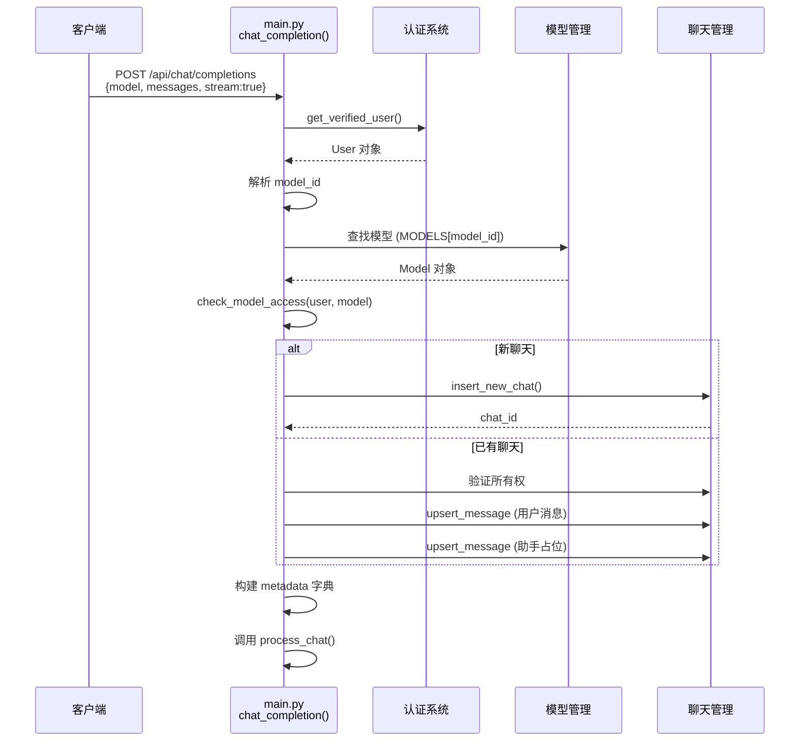

### 3.3 关键数据结构

```python
# metadata 字典结构
metadata = {
    'user_id': str,              # 用户 ID
    'chat_id': str,              # 聊天 ID
    'user_message': dict,        # 用户消息
    'user_message_id': str,      # 用户消息 ID
    'assistant_message_id': str, # 助手消息 ID
    'session_id': str,           # WebSocket 会话 ID
    'filter_ids': list,          # 过滤函数 ID 列表
    'tool_ids': list,            # 工具 ID 列表
    'tool_servers': list,        # 直接工具服务器
    'files': list,               # 文件列表
    'features': dict,            # 功能特性 (web_search, code_interpreter 等)
    'variables': dict,           # 变量
    'model': dict,               # 模型信息
    'params': dict,              # 参数 (stream_delta_chunk_size, reasoning_tags 等)
}
```

---

## 4. 阶段二：Payload 处理管道

### 4.1 管道概览

**文件**: `backend/open_webui/utils/middleware.py` → `process_chat_payload()` (第 2248 行)

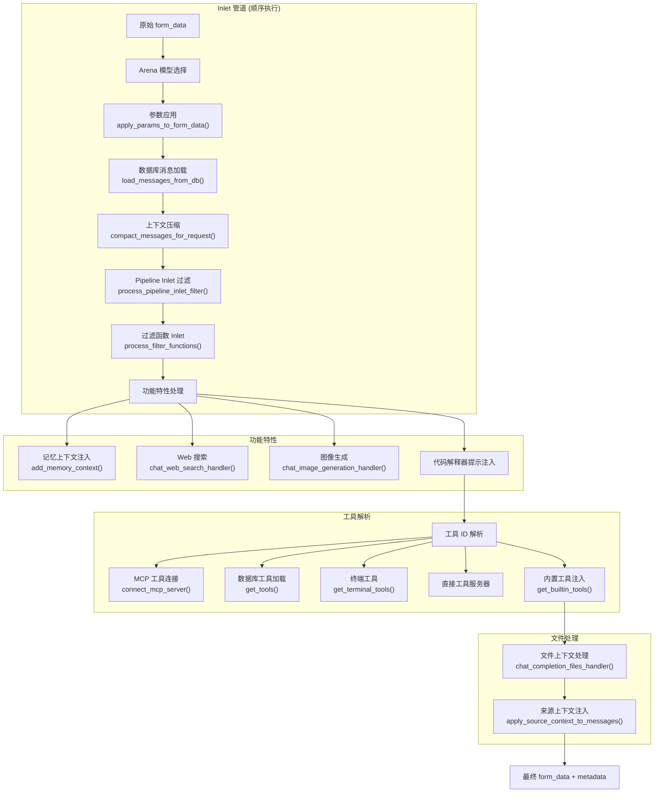

### 4.2 内置工具注入

当 `use_builtin_tools = True` 时，系统根据启用的功能和模型能力自动注入内置工具：

| 工具函数 | 触发条件 | 文件 |
|----------|----------|------|
| `web_search` | `features.web_search` | `tools/builtin.py` |
| `fetch_url` | 始终可用 | `tools/builtin.py` |
| `query_knowledge_files` | 模型关联知识库 | `tools/builtin.py` |
| `view_knowledge_file` | 模型关联知识库 | `tools/builtin.py` |
| `query_chat_files` | 聊天有文件 | `tools/builtin.py` |
| `view_file` | 聊天有文件 | `tools/builtin.py` |
| `generate_image` | `features.image_generation` | `tools/builtin.py` |
| `execute_code` | `features.code_interpreter` | `tools/builtin.py` |
| `delegate_task` | `ENABLE_SUBAGENTS=true` | `tools/builtin.py` |
| `timer` | 始终可用 | `tools/builtin.py` |
| `view_skill` | 有可用技能 | `tools/builtin.py` |
| `search_channels` | 频道功能启用 | `tools/builtin.py` |
| `add_memory` | 记忆系统启用 | `tools/builtin.py` |
| `search_memories` | 记忆系统启用 | `tools/builtin.py` |

---

## 5. 阶段三：LLM 生成

### 5.1 生成入口

**文件**: `backend/open_webui/utils/chat.py` → `generate_chat_completion()` (第 151 行)

### 5.2 路由逻辑

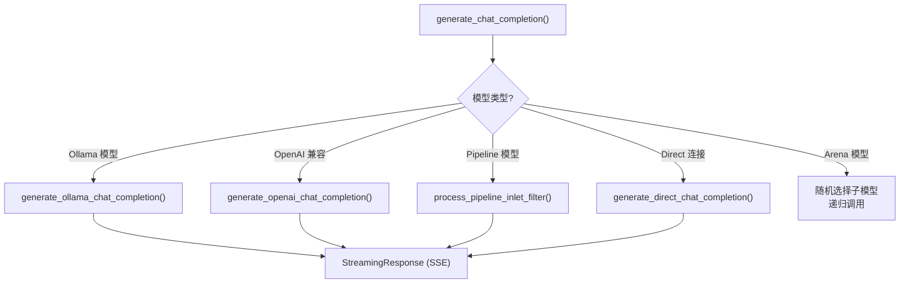

### 5.3 流式响应格式

```json
// SSE 事件流
data: {"choices":[{"delta":{"content":"Hello"}}]}

data: {"choices":[{"delta":{"content":" world"}}]}

data: [DONE]
```

---

## 6. 阶段四：工具调用循环

这是 Agent 系统的核心机制，允许 LLM 在生成过程中多次调用工具。

### 6.1 循环流程

**文件**: `backend/open_webui/utils/middleware.py` → `streaming_chat_response_handler()` (第 3750 行)

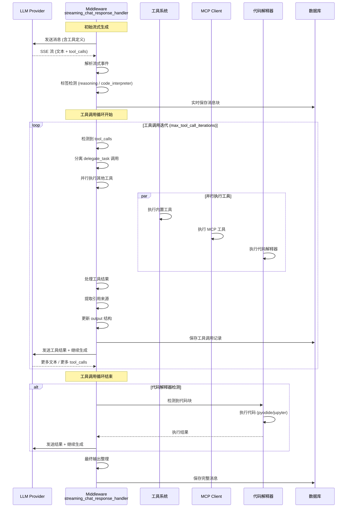

### 6.2 关键配置

| 配置项 | 默认值 | 说明 |
|--------|--------|------|
| `CHAT_RESPONSE_MAX_TOOL_CALL_ITERATIONS` | 20 | 最大工具调用迭代次数 |
| `max_tool_call_iterations` (request.state) | 同上 | 可被子代理覆盖 |

### 6.3 Output 结构

工具调用过程中，响应被组织为结构化的 `output` 数组：

```typescript
type OutputItem = 
  | { type: 'message'; id: string; role: 'assistant'; content: OutputText[]; status: 'in_progress' | 'completed' }
  | { type: 'reasoning'; id: string; content: OutputText[]; status: 'in_progress' | 'completed'; duration?: number }
  | { type: 'function_call'; id: string; call_id: string; name: string; arguments: string; status: 'in_progress' | 'completed' }
  | { type: 'function_call_output'; id: string; call_id: string; output: OutputPart[]; status: 'completed'; files?: File[] }
  | { type: 'open_webui:code_interpreter'; id: string; code: string; output?: string; status: 'in_progress' | 'completed' }
```

### 6.4 工具调用并行执行

`delegate_task` 调用与其他工具调用**并行执行**：

```python
# middleware.py 第 5009-5023 行
delegate_calls = [
    tool_call for tool_call in response_tool_calls
    if tool_call.get('function', {}).get('name') == 'delegate_task'
]

# 先执行非 delegate 工具
for tool_call in response_tool_calls:
    if tool_call.get('function', {}).get('name') != 'delegate_task':
        tool_results[id(tool_call)] = await execute_tool_call(tool_call)

# delegate 工具并行执行
tool_results.update(
    zip(
        [id(tool_call) for tool_call in delegate_calls],
        await asyncio.gather(
            *(execute_tool_call(tool_call) for tool_call in delegate_calls)
        ),
    )
)
```

---

## 7. 阶段五：子代理委派

### 7.1 委派流程

**文件**: 
- `backend/open_webui/tools/builtin.py` → `delegate_task()` (第 1520 行)
- `backend/open_webui/utils/subagents.py` → `delegate()` (第 270 行)

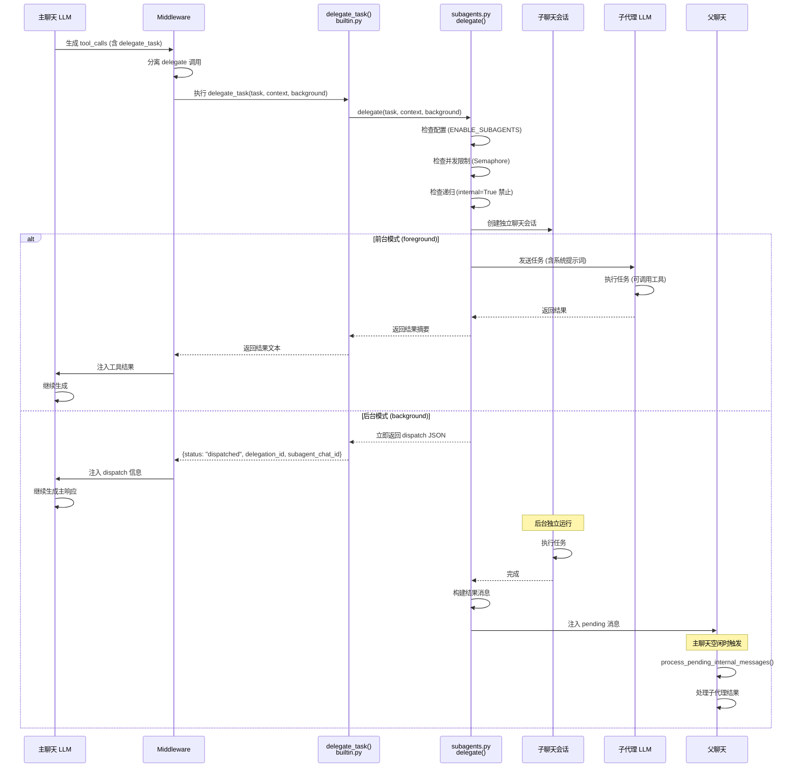

### 7.2 子代理系统提示词

默认提示词：
```
You are a sub-agent working on a specific task assigned by the lead agent.

You have full access to the workspace — you can read, write, edit files, and run commands.
Focus exclusively on your assigned task. Do NOT work on anything outside your scope.

When done, end with a clear summary:
- What you did
- What files you changed (if any)
- Any issues or open questions
```

可通过 `SUBAGENTS_SYSTEM_PROMPT` 环境变量或管理后台自定义。

### 7.3 并发控制

```python
# 前台子代理：信号量控制
_foreground_semaphore = asyncio.Semaphore(max_concurrent)

# 后台子代理：集合跟踪
_background_active: set[str] = set()  # 存储活跃的 delegation_id
```

### 7.4 定时器集成

**文件**: `backend/open_webui/tools/builtin.py` → `timer()` (第 1570 行)

定时器允许 Agent 设置一次性定时任务：

```python
async def timer(
    prompt: str,                    # 定时触发时发送的提示词
    at: str,                        # 相对时间 (10s, 5m, 1h) 或 RFC 3339 时间戳
    cancel_on: list[str] | None,    # 取消事件 (chat.read, chat.user_message)
) -> str
```

---

## 8. 阶段六：响应处理与后台任务

### 8.1 响应处理

**文件**: `backend/open_webui/utils/middleware.py` → `process_chat_response()` (第 5656 行)

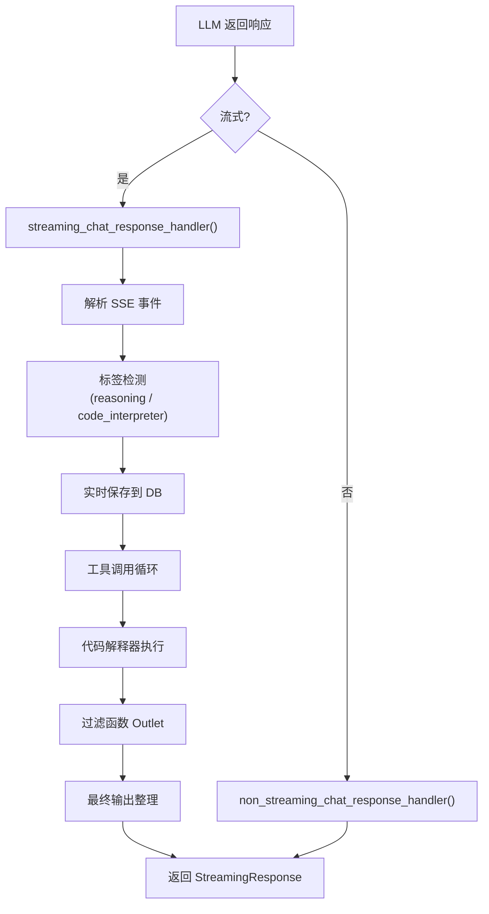

### 8.2 后台任务

**文件**: `backend/open_webui/utils/middleware.py` → `background_tasks_handler()` (第 3194 行)

响应完成后，异步执行以下后台任务：

| 任务 | 说明 | 触发条件 |
|------|------|----------|
| 标题生成 | 为聊天生成标题 | 新聊天 |
| 标签生成 | 为消息生成标签 | 配置启用 |
| 后续问题生成 | 生成建议的后续问题 | 配置启用 |
| 子代理结果处理 | 处理后台子代理的 pending 消息 | 有 pending 消息 |

### 8.3 完整响应示例

```json
{
  "id": "chat-xxx",
  "model": "gpt-4",
  "choices": [{
    "index": 0,
    "delta": {
      "content": "最终响应文本",
      "reasoning_content": "思考过程"
    },
    "finish_reason": "stop"
  }],
  "usage": {
    "prompt_tokens": 100,
    "completion_tokens": 50,
    "total_tokens": 150
  }
}
```

---

## 9. Agent 扩展机制

Open WebUI 的 Agent 系统提供了 **4 种扩展机制**，允许开发者自定义 Agent 的行为、添加新能力、接入外部服务。

### 9.1 扩展机制总览

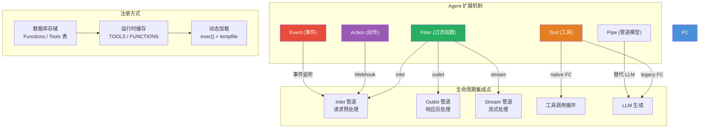

### 9.2 四种扩展类型

| 类型 | 基类 | 生命周期钩子 | 用途 | 启用条件 |
|------|------|-------------|------|----------|
| **Pipe** | `class Pipe` | `pipe()` | 替代 LLM 提供商，自定义模型管道 | `ENABLE_PLUGINS=true` |
| **Filter** | `class Filter` | `inlet()`, `outlet()`, `stream()` | 拦截/修改请求和响应 | `ENABLE_PLUGINS=true` |
| **Tool** | `class Tools` | 任意自定义函数 | 为 Agent 添加新工具能力 | `ENABLE_PLUGINS=true` |
| **Action** | `class Action` | `action()` | Webhook 风格的外部动作 | `ENABLE_PLUGINS=true` |
| **Event** | `class Event` | `event()` | 事件驱动的处理 | `ENABLE_PLUGINS=true` |

### 9.3 Pipe — 自定义模型管道

**文件**: `backend/open_webui/functions.py` → `generate_function_chat_completion()`

Pipe 是最强大的扩展方式，它**完全替代 LLM 提供商**，可以接入任何自定义模型或服务。

```python
from pydantic import BaseModel, Field
from typing import Any, AsyncGenerator, Generator

class Pipe:
    class Valves(BaseModel):
        api_key: str = Field(default="")
        api_url: str = Field(default="https://api.example.com")
    
    def __init__(self):
        self.type = "manifold"  # 或 "pipe"
        self.id = "my_custom_pipe"
        self.name = "My Custom Pipe"
    
    # 单模型模式
    async def pipe(
        self,
        body: dict,           # 请求体 (messages, model, stream 等)
        __user__: dict,       # 用户信息
        __event_emitter__: Any,  # 事件发射器
        __event_call__: Any,     # 事件调用器
        __tools__: dict,      # 可用工具
        __metadata__: dict,   # 元数据
    ) -> str | Generator | AsyncGenerator:
        """
        返回: str (非流式) 或 Generator/AsyncGenerator (流式)
        """
        messages = body.get("messages", [])
        # 自定义处理逻辑
        return "Response"
    
    # 多模型模式 (manifold)
    def pipes(self) -> list[dict]:
        return [
            {"id": "model-1", "name": "Model 1"},
            {"id": "model-2", "name": "Model 2"},
        ]
```

**生命周期集成点**:
```
用户请求 → Pipe.pipe() → 自定义处理 → 返回 StreamingResponse
```

**典型用途**:
- 接入自定义 LLM API
- 添加请求/响应转换层
- 实现模型路由/负载均衡
- 添加缓存层

---

#### Filter — 过滤函数

**文件**: `backend/open_webui/utils/filter.py` → `process_filter_functions()`

Filter 在 Agent 生命周期的 **3 个关键节点** 注入自定义逻辑：

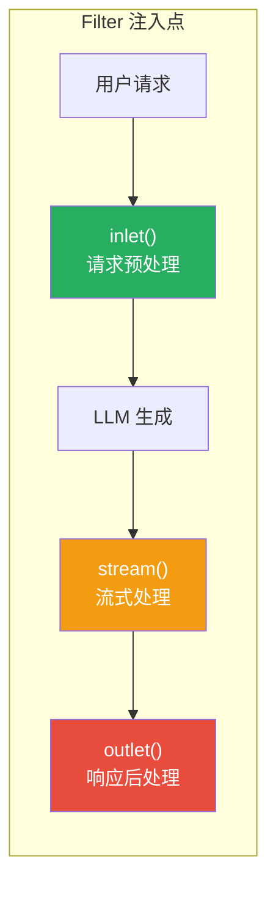

```python
from pydantic import BaseModel, Field

class Filter:
    class Valves(BaseModel):
        priority: int = Field(default=0)
        custom_param: str = Field(default="")
    
    class UserValves(BaseModel):
        user_config: str = Field(default="")
    
    def __init__(self):
        self.type = "filter"
        self.id = "my_filter"
        self.name = "My Filter"
        
        # 可选：标记为文件处理器（会移除文件）
        self.file_handler = False
        
        # 可选：标记为开关型（用户可在聊天中启用/禁用）
        self.toggle = False
    
    async def inlet(
        self,
        body: dict,           # 请求体（可修改）
        __user__: dict,       # 用户信息
        __event_emitter__: Any,
    ) -> dict:
        """
        在 LLM 生成前处理请求。
        可以修改 messages、添加 system prompt、注入上下文等。
        """
        # 添加自定义系统提示
        body["messages"] = add_or_update_system_message(
            "Custom instruction",
            body["messages"],
        )
        return body
    
    async def outlet(
        self,
        body: dict,          # 响应体（可修改）
        __user__: dict,
        __event_emitter__: Any,
    ) -> dict:
        """
        在 LLM 响应后处理。
        可以修改响应内容、添加后处理逻辑。
        """
        return body
    
    async def stream(
        self,
        event: dict,         # 流式事件
    ) -> dict:
        """
        处理流式响应中的每个事件。
        """
        return event
```

**生命周期集成点**:
```
请求 → inlet() → LLM 生成 → stream() → outlet() → 响应
```

**典型用途**:
- 内容审核/敏感词过滤
- 自定义系统提示注入
- 响应格式转换
- 审计日志记录
- 多轮对话上下文管理

---

### 9.4 Tool — 自定义工具

**文件**: `backend/open_webui/utils/tools.py` → `get_tools()`, `get_builtin_tools()`

Tool 是 Agent **工具调用循环** 的核心扩展方式。每个工具是一个 Python 函数，Agent 可以在生成过程中调用。

```python
from pydantic import BaseModel, Field
from typing import Any

class Tools:
    class Valves(BaseModel):
        api_key: str = Field(default="")
    
    class UserValves(BaseModel):
        user_token: str = Field(default="")
    
    def __init__(self):
        self.citation = True  # 启用引用来源
        self.file_handler = False  # 标记为文件处理器
    
    async def get_weather(
        self,
        location: str,       # 工具参数（自动生成 OpenAI 函数规范）
        __user__: dict,      # 用户信息
        __event_emitter__: Any,  # 事件发射器
    ) -> str:
        """
        获取指定位置的天气信息。
        
        :param location: 城市名称，如 "北京"
        :return: 天气信息字符串
        """
        # 工具逻辑
        return f"{location} 的天气是晴天，25°C"
```

**工具注册流程**:
```
1. 用户在管理后台创建工具（Python 代码）
2. 系统通过 exec() 动态加载到运行时
3. 自动提取函数签名 → OpenAI 函数规范 (JSON Schema)
4. 在 process_chat_payload() 中注入到 form_data['tools']
5. LLM 在生成时选择调用工具
6. Middleware 执行工具函数并返回结果
```

**内置工具 vs 自定义工具**:

| 特性 | 内置工具 | 自定义工具 |
|------|----------|------------|
| 定义位置 | `tools/builtin.py` | 管理后台 → 工具 |
| 加载方式 | 代码硬编码 | 数据库存储 + 动态加载 |
| 注入条件 | 功能特性 + 模型能力 | 用户选择 + 访问控制 |
| 示例 | `web_search`, `execute_code` | 自定义 API 工具 |

**工具调用流程**:
```
LLM 生成 tool_calls
    → Middleware 解析
    → 并行执行（delegate_task 与其他工具分离）
    → 处理结果（引用提取、文件处理）
    → 结果注入回 LLM
    → LLM 继续生成
```

---

### 9.5 Action — 动作

**文件**: `backend/open_webui/utils/actions.py`

Action 提供 Webhook 风格的扩展，当特定事件发生时触发。

```python
class Action:
    def __init__(self):
        self.type = "action"
        self.name = "My Action"
    
    async def action(
        self,
        body: dict,          # 请求体
        __user__: dict,
        __event_emitter__: Any,
    ) -> dict:
        """处理动作并返回结果"""
        return body
```

---

### 9.6 Event — 事件

**文件**: `backend/open_webui/events.py`

Event 允许监听系统事件并做出响应。

```python
class Event:
    def __init__(self):
        self.type = "event"
        self.name = "My Event Handler"
    
    async def event(
        self,
        event: dict,         # 事件数据
        __user__: dict,
    ) -> None:
        """处理事件"""
        pass
```

---

### 9.7 扩展加载机制

**文件**: `backend/open_webui/utils/plugin.py`

所有扩展通过 **动态模块加载** 机制运行：

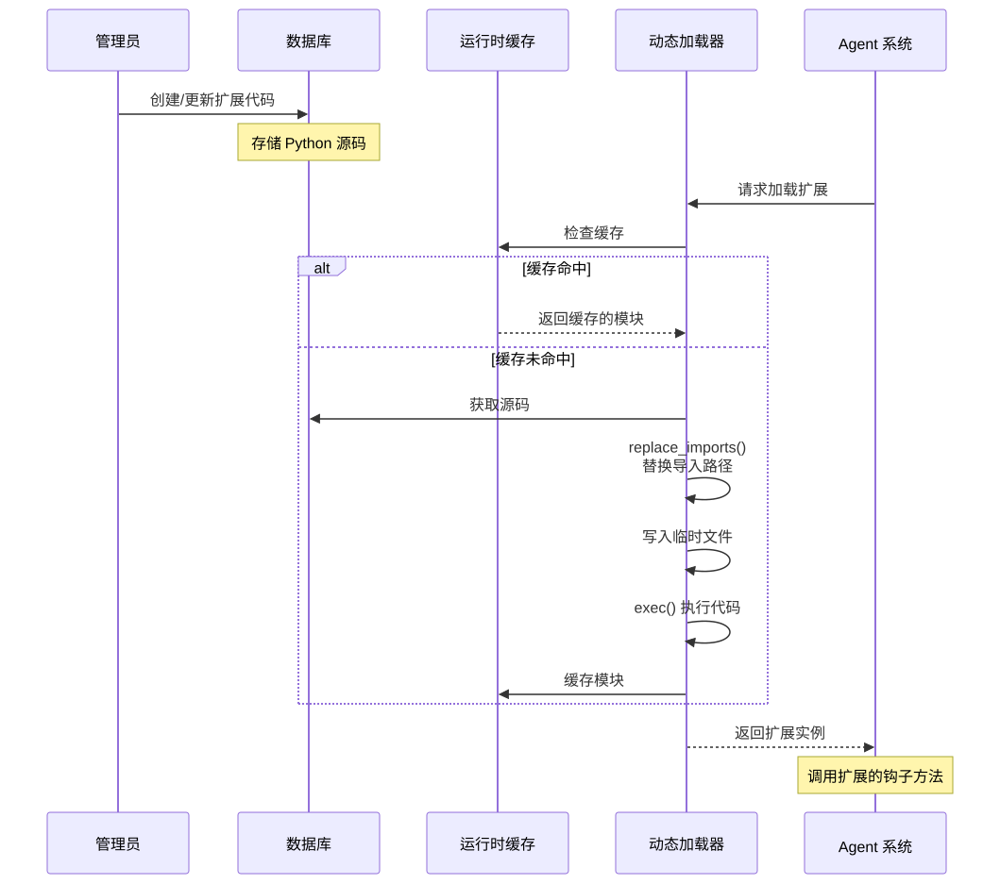

**关键特性**:

1. **热加载**: 代码变更后自动重新加载（通过内容哈希比较）
2. **依赖管理**: 支持 frontmatter 中的 `requirements` 字段自动 pip install
3. **Valves 系统**: 类型安全的配置管理，支持动态选项
4. **缓存机制**: 两级缓存（内存 + 内容哈希），避免重复加载
5. **沙箱隔离**: 每个扩展运行在独立的 `types.ModuleType` 中

**Frontmatter 示例**:
```python
"""
requirements: requests, beautifulsoup4
"""
from pydantic import BaseModel, Field

class Tools:
    ...
```

---

### 9.8 扩展与 Agent 生命周期集成图


---

## 10. 关键文件与函数索引

### 9.1 核心文件

| 文件 | 职责 | 关键函数 |
|------|------|----------|
| `backend/open_webui/main.py` | FastAPI 应用入口，路由定义 | `chat_completion()` (第 1054 行) |
| `backend/open_webui/utils/middleware.py` | 请求处理管道核心 | `process_chat_payload()` (第 2248 行), `streaming_chat_response_handler()` (第 3750 行), `process_chat_response()` (第 5656 行), `background_tasks_handler()` (第 3194 行) |
| `backend/open_webui/utils/chat.py` | LLM 生成引擎 | `generate_chat_completion()` (第 151 行) |
| `backend/open_webui/utils/subagents.py` | 子代理引擎 | `delegate()` (第 270 行), `process_pending_internal_messages()` (第 51 行) |
| `backend/open_webui/tools/builtin.py` | 内置工具定义 | `delegate_task()` (第 1520 行), `timer()` (第 1570 行) |
| `backend/open_webui/utils/tools.py` | 工具注册与管理 | `get_builtin_tools()`, `get_tools()` |
| `backend/open_webui/utils/timers.py` | 定时器引擎 | `create_timer()` |
| `backend/open_webui/utils/filter.py` | 过滤函数管道 | `process_filter_functions()` |
| `backend/open_webui/config.py` | 配置项 | `ENABLE_SUBAGENTS`, `SUBAGENTS_*` 等 |

### 9.2 关键配置项

| 环境变量 | 默认值 | 说明 |
|----------|--------|------|
| `ENABLE_SUBAGENTS` | `false` | 启用子代理系统 |
| `SUBAGENTS_BACKGROUND_ENABLED` | `false` | 启用后台子代理 |
| `SUBAGENTS_MAX_CONCURRENT` | `20` | 前台子代理最大并发数 |
| `SUBAGENTS_MAX_ASYNC` | `20` | 后台子代理最大并发数 |
| `SUBAGENTS_MAX_ITERATIONS` | `30` | 每个子代理最大工具循环次数 |
| `SUBAGENTS_MAX_OUTPUT` | `30000` | 子代理结果摘要最大字符数 |
| `SUBAGENTS_SYSTEM_PROMPT` | `''` | 子代理系统提示词 |

### 9.3 前端组件

| 组件 | 文件 | 说明 |
|------|------|------|
| Subagents 设置 | `src/lib/components/admin/Settings/Subagents.svelte` | 管理后台子代理配置 |
| SubagentResultRow | `src/lib/components/chat/Messages/SubagentResultRow.svelte` | 后台子代理结果展示 |
| UserMessage | `src/lib/components/chat/Messages/UserMessage.svelte` | 用户消息（含子代理标记） |

---

> 本文档基于 Open WebUI 源码分析生成，版本对应 main 分支最新代码。